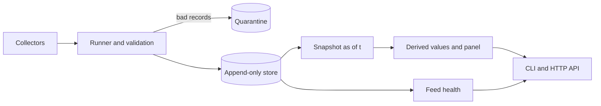

# eventlake

eventlake collects prediction-market prices (Kalshi, Polymarket), option implied vols
(Tradier), macro series (FRED, CFTC, SEC EDGAR) and weather (NOAA) into an append-only DuckDB
store where every row records both when it happened (`event_time`) and when it could have
been known (`knowledge_time`). Every read goes through `store.as_of(ts)`, so a question like
"what did markets say the day before the September FOMC meeting" is answered only from data
that existed then, including values that were later revised. On top of the store it builds a
per-event panel (FOMC, CPI) that sets the prediction-market probability and the option-implied
move known before each event beside the move that followed.

## Quickstart

```
uv sync && uv run eventlake demo --offline
```

The offline demo needs no keys and no network. It replays public data recorded on 2026-11-20
through the real collectors' `normalize`, the real runner and the store. The market
probabilities and realised moves are recorded public data. The `implied move (synthetic
sample)` column is the real solver run on an illustrative IV sample, because recorded option
history is not included (see `src/eventlake/demo_data/synthetic/README.md`). Real output:

```
eventlake offline demo
Replaying public data recorded 2026-11-20 (Kalshi, Polymarket, FRED SP500, NOAA) through the real collectors and runner. No network is used.
Demo clock fixed at 2026-11-19T18:00Z.

1. As known the day before each event
event            as of (UTC)        top market                                                    market prob  implied move (synthetic sample)  realised move
---------------  -----------------  ------------------------------------------------------------  -----------  -------------------------------  -------------
FOMC:2026-06-17  2026-06-16T18:00Z  polymarket: Will there be no change in Fed interest rates...  99.5%        0.80%                            -
FOMC:2026-07-29  2026-07-28T18:00Z  polymarket: Will there be no change in Fed interest rates...  72.1%        0.85%                            -
CPI:2026-08-12   2026-08-11T12:30Z  kalshi: Will CPI rise more than 0.0% in July 2026?            62.0%        0.70%                            -
CPI:2026-09-11   2026-09-10T12:30Z  kalshi: Will CPI rise more than 0.3% in August 2026?          60.0%        0.60%                            -
FOMC:2026-09-16  2026-09-15T18:00Z  polymarket: Will the Fed increase interest rates by 25 bp...  87.5%        0.85%                            -
CPI:2026-10-14   2026-10-13T12:30Z  kalshi: Will CPI rise more than 0.5% in September 2026?       62.0%        0.70%                            -
FOMC:2026-10-28  2026-10-27T18:00Z  polymarket: Will there be no change in Fed interest rates...  93.5%        0.80%                            -
CPI:2026-11-10   2026-11-09T13:30Z  kalshi: Will CPI rise more than 0.2% in October 2026?         62.0%        0.65%                            -
The 'implied move (synthetic sample)' column is computed by the real solver from illustrative inputs; the other columns come from recorded public data.

2. The same events, as known two days after each
event            as of (UTC)        top market                                                    market prob  implied move (synthetic sample)  realised move
---------------  -----------------  ------------------------------------------------------------  -----------  -------------------------------  -------------
FOMC:2026-06-17  2026-06-19T18:00Z  polymarket: Will there be no change in Fed interest rates...  99.6%        -                                1.21%
FOMC:2026-07-29  2026-07-31T18:00Z  kalshi: Will the Federal Reserve Hike rates by 0bps a...      75.0%        -                                1.52%
CPI:2026-08-12   2026-08-14T12:30Z  kalshi: Will CPI rise more than 0.0% in July 2026?            67.0%        -                                0.26%
CPI:2026-09-11   2026-09-13T12:30Z  kalshi: Will CPI rise more than 0.3% in August 2026?          59.0%        -                                0.86%
FOMC:2026-09-16  2026-09-18T18:00Z  polymarket: Will the Fed increase interest rates by 25 bp...  88.5%        -                                0.45%
CPI:2026-10-14   2026-10-16T12:30Z  kalshi: Will CPI rise more than 0.5% in September 2026?       68.0%        -                                1.11%
FOMC:2026-10-28  2026-10-30T18:00Z  kalshi: Will the Federal Reserve Hike rates by 0bps a...      96.0%        -                                0.28%
CPI:2026-11-10   2026-11-12T13:30Z  kalshi: Will CPI rise more than 0.2% in October 2026?         56.0%        -                                0.38%

3. What changed between the two tables (number of events)
column                           empty to filled  filled to empty  value changed
-------------------------------  ---------------  ---------------  -------------
market prob                      0                0                8
implied move (synthetic sample)  0                8                0
realised move                    8                0                0
A realised move exists only once the close is known; an implied move is only defined before its event.
Each row in table 1 was recomputed from a store holding only data known at its as-of time, and matched.

Feed health (runs are stamped with the demo clock)
feed             status  freshness  last_run  volume  quarantine  gaps
---------------  ------  ---------  --------  ------  ----------  ----
fred             OK      ok         ok        ok      ok          ok
kalshi           OK      ok         ok        ok      ok          ok
noaa             WARN    ok         ok        ok      ok          warn
polymarket       OK      ok         ok        ok      ok          ok
tradier.options  OK      ok         ok        ok      ok          ok

Issues:
  noaa gaps [warn]: missing USW00094728:TMAX: 2026-11-16, 2026-11-17 (weekdays 2026-10-19 to 2026-11-17; no holiday calendar, so market holidays show as gaps)

tradier.options is the synthetic sample; cftc and edgar are not part of the demo.
A noaa gap warning is genuine: the recorded summaries trail the demo clock.
```

## Architecture



Collectors only fetch and normalise. `runner.run_collector` validates, quarantines bad records,
appends the batch in one transaction and writes one `feed_runs` row per run, which the health
checks read. `Snapshot` is the only read path for observations. Design notes:
[docs/design.md](docs/design.md).

## Point-in-time model

Each `Observation` has `event_time` (the instant the value describes), `knowledge_time` (the
earliest instant it could have been known; never before `event_time`) and `kt_quality`, which
says where that knowledge time came from: `source` (a vendor timestamp or a published release
schedule), `observed` (the time eventlake fetched it) or `assumed` (a fixed lag rule).

Revision example, illustrative numbers: FRED's keyless CSV gives the SP500 close for
2026-03-02 as 6850.10, stored with `knowledge_time` 2026-03-03T00:00Z (`assumed`). A run on
2026-03-20 finds 6851.40 for the same date. Same key, different value, so the store appends a
second version with `knowledge_time` set to that run's start and `kt_quality` `observed`.
`as_of(2026-03-10)` still returns 6850.10; `as_of(2026-03-21)` returns 6851.40. Nothing is
updated or deleted. Two guarantees are enforced by tests:

- No read returns a row whose `knowledge_time` is after the as-of time:
  `tests/test_store.py` (`test_no_leak_property`, randomised) and `tests/test_panel.py`
  (`test_panel_no_leak`, which appends later revisions and checks the panel is unchanged).
- Re-ingesting does not duplicate versions: a row is stored only if its value differs from the
  version visible at its knowledge time (`tests/test_store.py::test_reingest_is_idempotent`,
  `tests/test_runner.py::test_rerun_same_window_writes_zero`).

## Feeds

| Feed | Source | Auth | Knowledge time | Quality |
|---|---|---|---|---|
| `kalshi` | Kalshi trade API v2, daily candles; historical endpoints for older settled markets | none | end of the candle period | `source` |
| `polymarket` | Gamma events API and CLOB daily price history of the YES token | none | timestamp of the price point | `source` |
| `tradier.options` | Tradier quotes with greeks, ATM call and put per expiry | `TRADIER_TOKEN` | fetch time | `observed` |
| `fred` | FRED keyless CSV: SP500, DFF, CPIAUCSL | none | SP500, DFF: observation date + 1 day + lag (0, 1 day). CPIAUCSL: the first CPI release in the packaged calendar after the reference month ends; outside the calendar, month end + 45 days | `assumed`; CPIAUCSL `source` (fallback `assumed`) |
| `noaa` | NCEI Access Data Service, daily TMAX, Central Park | none | observation date + 36 hours | `assumed` |
| `cftc` | CFTC Socrata, Traders in Financial Futures, E-mini S&P 500 | none | first Friday at least 3 days after the report date, 15:30 New York | `source` |
| `edgar` | SEC submissions JSON, Form 4 count per filing day | `EVENTLAKE_CONTACT` (User-Agent) | latest acceptance time that day | `source` |

## Design decisions

| Decision | Alternative considered | Why |
|---|---|---|
| Append-only versions keyed by (feed, series, event_time, knowledge_time) | Upsert the latest value | An upsert erases what was known earlier, which is what a point-in-time store exists to keep. A test fails if the source contains `UPDATE` or `DELETE FROM`. |
| Store a row only when the value changes | Store every fetch | Scheduled re-runs cost nothing and every stored version is a real change. |
| Derived values computed from a `Snapshot` on read | Materialised derived tables | A stored derived value needs its own knowledge time and recomputation on every revision; computing from a snapshot inherits the as-of guarantee. |
| One `Collector` protocol and one runner that quarantines | Per-feed ingest scripts | Validation, quarantine, run records and health live in one place; a bad record never drops the batch. |
| Declared `kt_quality` per row | Treat every knowledge time as exact | Keyless sources do not say when a value was published; the flag makes the assumption visible and filterable. |
| Rule-based linking by series and time tolerance; unmatched markets stay unlinked; links are never moved | Fuzzy title matching | A wrong link is worse than a missing one, and rules can be read and tested. |
| DuckDB file | A database server | No service to run, columnar scans for panels, one file to copy. The cost is a single writer. |

## Limitations

- FRED daily series and NOAA knowledge times are assumed from a fixed lag. FRED's vintage API
  (ALFRED) would replace the assumption for FRED with recorded release dates.
- CPIAUCSL is matched to the calendar on the assumption of one CPI release per reference
  month: a month whose release was cancelled is dated at the next release that exists.
- CFTC knowledge time does not model releases delayed by holidays.
- Events and market-to-event links are reference data read as currently stored. A market
  linked later can change which already-priced market a past panel row shows (only to one
  priced at that as-of time; `test_late_link_can_only_surface_prices_already_known`).
- The health gap check counts weekdays and has no holiday calendar.
- The event calendar is a hand-maintained set of CSVs covering 2025-2026.
- DuckDB allows one writer per file. `serve` holds the database open, so stop it before
  running `ingest` or `backfill` against the same file.
- The Tradier collector is built from the documented API; its test fixtures are hand-built
  from documented response shapes and it has not been run against the live API.
- Implied-move history needs recorded option data, which is not included; a live store
  accrues it only from the day option snapshots start being collected.
- The live (non-offline) demo path is not covered by automated tests.

## Running live

Configuration is by environment variable (see `.env.example`): `EVENTLAKE_DB` (default
`data/eventlake.duckdb`), `TRADIER_TOKEN` and `TRADIER_BASE` (default the Tradier sandbox),
`EVENTLAKE_CONTACT` (required by the EDGAR feed), `EVENTLAKE_ALERT_WEBHOOK`. `backfill` skips
a collector whose setting is missing and says so.

```
uv run eventlake backfill --start 2025-01-01       # calendar, markets, every collector, links
uv run eventlake ingest kalshi --start 2026-11-01  # one feed over a window
uv run eventlake health --alert                    # exit 1, and post to the webhook, if a feed fails
uv run eventlake export panel.parquet              # day-before-event panel as Parquet
uv run eventlake serve --port 8000                 # read-only API: /events /observations /panel /feeds
```

`serve` binds 127.0.0.1 unless given `--host`. `/observations` and `/panel` take `as_of` as
ISO-8601 with a UTC offset. The Dockerfile runs `serve --host 0.0.0.0 --port 8000`; the store
lives at `/app/data/eventlake.duckdb` unless `EVENTLAKE_DB` says otherwise:

```
docker build -t eventlake . && docker run -p 8000:8000 -v "$PWD/data:/app/data" eventlake
```

## Licence

MIT, see [LICENSE](LICENSE).
